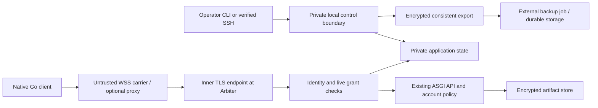

# Authentication and mutual enrollment: high-level design

Stage: HLD candidate, 2026-10-20. The [stamped requirements](requirements.md)
are normative; their SHA-256 is
`d56e92a7cb01f131ba499650c4a5d7b2c8d17adf2cdc7d612eee7c5f53d07929`.
This document selects components, responsibilities, state transitions and failure
boundaries. It is not a wire specification, sliced implementation plan, implemented
security fix or release approval. Actual DBB must approve these exact bytes before
a durable design stamp. Review verdicts live in separate evidence, not in this
document's mutable status text. The earlier synthesis and H1–H5 contracts are
context; choices retained below become this HLD's design decisions.

## Shared architecture and trust

One trusted operator owns the server, upstream passwords and account policies.
Lightweight agents may read their own private credentials. They cannot read the
operator recovery file. Prompt injection can misuse an agent's allowed authority;
this design does not solve that risk. Future isolation uses a sandboxed agent and
trusted key-holding broker, potentially Reploy controlled sessions. Helpers use
the parent's identity and grants. No external identity account, daemon, provider
framework, browser UI or cluster is introduced. (R01–R03)

The Python server owns authorization state, issuer keys, retained artifact keys
and upstream secrets. The Go client owns access/portable/recipient private keys
and remembered server trust. Forwarders see routing/timing and may deny service;
they never terminate native inner encryption. Local control is administrative
authority; an ordinary enrolled client is not an administrator. Existing plugin
selection, policies, operation errors, worker admission and body limits remain.

Keep the native HTTP API shape and ASGI application. Add an authenticated stream
adapter and immutable caller context, not another operation/policy engine. The
public listener exposes only minimal health, bounded enrollment bootstrap and
opaque native carriers. Disable ordinary anonymous API and artifact routes;
HTTP proxy identity headers cannot create caller context. Schema/catalog/direct
lookup all pass the same live grant check. (R10–R14)

### State and concurrency ownership

Use one private SQLite authority database, one active server process and a bounded
single-writer executor; SQLite provides transactions, not a multi-server protocol.
Records include owner/server/agent IDs, enrollment and key versions, denials,
grants, pending transitions and completion results. Random UUIDs are durable IDs;
certificate serials, names, URLs and key fingerprints are attributes. No public
registry or external ID service is required. Revision fields are local compare-
and-swap state, never the rejected migration-generation mechanism.

An in-process authority coordinator serializes dispatch admission and denial.
It checks live enrollment/grant/version and reserves request ownership before
starting upstream work. Revocation commits first under the same coordinator,
prevents later admission, cancels affected requests on every connection and
blocks further output. A still-running blocking call retains its existing worker
slot until it exits; cancellation cannot recall mail effects or delivered bytes.
The write path must not hold the event loop during SQLite/file/crypto work.
Read-only caches cannot authorize independently or outlive an authority revision.

SQLite transactions coordinate authority rows. Files use private staging and a
durable publication record: flush file, commit its hash/path reference, then
publish, with restart reconciliation of incomplete publications. No transaction
is claimed to atomically include arbitrary upstream mail or filesystem writes.
Private per-user/service directories, POSIX modes and existing Windows ACL
validation apply to databases, journals, staging, client state and recovery files.

## B2 — identity, grants and lifecycle

### Credential roles and verification

Use X.509 v3 certificates and P-256 signing/authentication keys, supported by
Python `cryptography` and Go `crypto/x509`/`crypto/tls`. Use SHA-256 signatures,
strict DER parsing and explicit purpose/issuer selection. Separate keypairs for
each role; do not convert signing keys into encryption keys. Random durable IDs
appear in SAN URIs of the form `urn:arbiter:<role>:<uuid>`, with server/enrollment
bindings in the access profile. These URI names label Arbiter records; they are
not a new globally federated identity protocol. (R04–R06)

| Role | Custody and allowed use |
| --- | --- |
| AMI owner issuer | Server-held CA cert/key; signs portable owner-approved identities. An independent server registers its public trust through local administration. |
| Server identity authority | Server-held CA cert/key, paired to a stable server ID; signs its inner server leaf and per-server access leaves. Never trust it as another server's owner issuer. |
| Portable agent identity | Agent-held non-CA leaf/key, signed by registered owner issuer; proves identity at enrollment only. Separate trust store, standard `clientAuth` EKU plus exact portable-role SAN; never accepted by ordinary native TLS. |
| Per-server access | Client-generated key, non-CA `clientAuth` leaf under that server's authority; SAN binds agent/server/enrollment IDs. Ordinary TLS additionally checks exact currently accepted key and live enrollment. |
| Inner server TLS | Non-CA `serverAuth` leaf/key under remembered server authority; expected durable server SAN checked instead of the carrier URL's DNS name. |
| Artifact recipient | Separate X25519/age keypair on client, registered by a signed request through the authenticated enrollment/access channel; server retains its public key/version. |
| Retained artifact storage | Separate server-held age identity; ciphertext is encrypted for both it and the creating client's registered recipient. |
| Backup origin | Separate server-held ES256 signing key; trusted public verifier retained externally in the operator recovery file. |
| Owner recovery | Separate external ES256 signer; server and paired clients hold its registered public verifier only. |
| Backup recipient | External age/X25519 private key in the same operator file; server/export job receives public recipient only. |

Every certificate verifier checks signature chain, exact registered issuer,
basic constraints/path length, key usage, EKU, exact role/IDs and allowed critical
extensions. CN/display names never authorize. CA keys have `keyCertSign` and no
ordinary leaf purpose; leaves cannot sign certificates. Portable certificates
use a distinct issuer/trust path and role check, despite sharing the standard
clientAuth EKU. A valid generic client certificate is insufficient. Reject
duplicate identity attributes and cross-role/cross-server credentials.

Access leaves have a 365-day validity window; the 30-day rotation and 24-hour
grace are independent earlier authorization checks. CA/portable/server leaf
renewal retains durable IDs and requires the appropriate existing signing and
live-state authority. Do not renew an expired server trust anchor merely because
a peer supplies a replacement. Track issuer renewal before expiration; missed
server trust validity needs operator recovery. Exact ASN.1 fixtures, URI grammar,
time skew, size constraints and certificate renewal schedules belong in the
implementation specifications; they cannot weaken the checks above.

Initial local setup creates owner/server authority and the one external operator
recovery file, confirms a private safe destination, registers recovery public
trust and backup public configuration, and never retains the external private
keys in running server state. Existing owner files can be reused through trusted
setup. The file prominently says it can both decrypt backups and authorize live
recovery. Jobs that export backups do not get that file. Client key files carry
`NEVER SHARE THIS`; doctor can recommend secure custody only once it exists.

### Enrollment authorization and grants

AMI assigns an agent ID only after exact owner approval; the client generates
provisional keys first. When reusing an existing portable identity, require a
registered owner issuer and a fresh signature by that identity, but still require
local enrollment approval and grants. Never take a requester-supplied root as
registration. Access keys are newly generated per server. Portable identity cannot
replace an existing access key, clear denial or automatically enroll. The owner
can register additional owner-issued agents without changing the trust model.

Grants map enrollment to configured `(plugin, account)` names. They filter all
discovery and direct calls before the existing account-policy flow. There is no
client operation allowlist or additional policy intersection. Repointing an
account deliberately carries its grants; use a new name for separation. Password
renewal needs no regrant. New grants need no re-enrollment. Removal is scoped to
that account; enrollment denial affects all its connections and transfers.

### Rotation and completion

| State/event | Result and authority |
| --- | --- |
| Authenticated contact, key age below 30 days | Normal access if live/valid; update last authenticated contact. |
| Due key authenticates | Record one pending rotation and fixed `prepared_at`/24-hour deadline before requesting a fresh candidate. Withholding candidate cannot reset it. |
| Client sends candidate public key | Bind it once to pending ID/version; issue its cert, client durably saves key/cert/trust, then proves candidate possession over the channel-bound rotation transcript. |
| Confirmation before inactivity cutoff | Conditional activation updates current/one predecessor, saves completion result and invalidates superseded sessions. Client durably promotes on authenticated receipt. |
| Missing confirmation before grace ends | Current key may still use normal operations; no repeated preparation. |
| After grace | Current old key cannot use ordinary APIs; only the fixed pending completion can proceed. |
| Old/candidate certificate expires | Ordinary verification remains strict. The restricted completion verifier may relax time only for the exact pending record; reissue a valid cert for the same candidate key. |
| 180 days without authenticated contact | Disable normal access and unattended completion; owner-approved pairing repair is required. Incomplete control exchanges never refresh this clock. |
| Denial or owner repair | Overrides all stale pending/completion state and sessions without changing grants or clearing denial. |

Current, predecessor and pending-candidate files are one durable client-state
transaction. Keep only one predecessor, discard on expiry, superseding recovery
or unenrollment. A verified server sends an authenticated credential-rejection
result through the control carrier, allowing one authentication-only predecessor
attempt. Raw TLS failure/timeout is not that evidence. No fallback after explicit
denial, identity failure, ambiguous result or attempted operation. The predecessor
must still be accepted by that server's restored state and satisfy every ordinary
validity/deadline/denial check. Never resend a mutation or consuming GET.

### Owner recovery and server replacement

Use a fixed JWS ES256 profile with purpose-tagged protected header and exact JSON
payload bytes; reject duplicate fields, algorithm substitution and unknown critical
headers. Select the registered verifier independently of incoming key headers.
The owner signs server ID, agent/enrollment ID, fresh challenge/request ID, expected
credential revision, exact replacement key, expiry and intended recovery purpose.
The replacement proves possession bound to this statement and verified channel.
One transaction consumes the event, changes the expected credential, saves the
idempotent result and invalidates sessions/pending transitions while preserving
grants and all denials. That signature is owner approval; no second approval at
each server. Local/SSH pairing repair remains the simple one-server alternative.

An owner-certified portable-key replacement additionally binds the old/new portable
key and stable identity, without issuing service access automatically. Multi-server
tooling prepares a server-specific authorization for each enrollment rather than
reusing one server's credential or sharing AMI private keys.

Planned server-key replacement is operator-triggered, not periodic: old authority
endorses the same durable server ID's new authority, new key proves possession,
and the client durably stores the transition before use. Retain transition evidence
to reach clients that have been offline within their allowed lifecycle; if history
is unavailable, diagnose repair instead of accepting arbitrary roots. Compromise
repair uses the independently registered owner recovery signature plus new-key
proof, never the compromised server key alone. Missing independent trust requires
explicit operator pairing. URL changes and HTTPS renewal do not replace identity.

## B1 — pairing and durable activation

Use `Noise_NNpsk0_25519_ChaChaPoly_SHA256`, client initiator/server responder,
with a 32-byte decoded PSK; reject missing/wrong-size PSKs before library setup.
Retain the prior Python/Go interoperability probe and its library-risk limitations.
The installed Python wrapper needs external frame limits and cannot itself supply
approval, replay accounting or activation. No short-code/PAKE implementation or
plaintext password transmission is introduced. (R07–R09)

1. Client starts enrollment for a URL and display name. It generates provisional
   access, portable (if new), recipient keys, a public random request selector
   and the 43-character PSK. It saves provisional keys privately and displays
   version/selector/PSK only through the explicit enrollment interaction.
2. A bounded anonymous request advertises selector, provisional public keys and
   untrusted labels. Closed enrollment explains local operator opening; it cannot
   open itself. A normally closed ten-minute operator window admits at most the
   configured twenty uncommitted records without a queue. Each record has its own
   immutable ten-minute creation deadline; reopening resets neither.
3. Local/SSH administration selects the exact request, reads PSK through protected
   input, approves immutable keys/grants and stores PSK only in bounded memory.
   Bind protocol, roles, selector, request digest and proposed keys in the Noise
   prologue and a non-empty first authenticated payload. A substituted request
   cannot authenticate against the actual client's key context.
4. Reserve separate connection/crypto capacity before parsing. Verify the PSK
   first flight before atomically charging a distinct admitted exchange. Exact
   authenticated first-flight digest replays reuse the same attempt/result owner;
   do not operate two mutable handshakes. At most five admitted failed/abandoned
   exchanges per request; anonymous failures spend no semantic attempt. The client
   confirms server identity/public trust and role-tagged transcript; server/client
   prove possession of their exact proposed signing keys.
5. Server returns a prepared result containing the reserved stable IDs, certificates,
   server/recovery public trust and grant summary inside Noise encryption. Client
   flushes its complete provisional trust/keys/result to private durable storage,
   then signs an explicit ready proof over the exact prepared result.
6. Conditional SQLite commit rechecks approval/revision, expiry, attempts, denial
   and account existence; it activates identity/access/grants and records the
   bounded completion result together. A signed leaf alone never authorizes before
   this commit. Server returns a receipt, client durably promotes enrollment.

Pending/approved/exchanging/prepared records remain uncommitted and count toward
twenty. Expiry/rejection/exhaustion removes provisional server state and signs no
usable activation. Restart loses PSKs and invalidates uncommitted contexts; client
receives a restart/expiry failure and explicitly starts again. Committed results
survive restart without PSKs. Client reconciles through remembered server trust
and a fresh proof by the approved access key; the bounded status carrier returns
only its exact completion result, never creates a second identity/grant. Live
denial supersedes retrieval. No unauthenticated ID lookup exposes result material.

Five first-flight digests plus one active exchange and one prepared result per
request bound replay state. Original ten-minute deadline bounds uncommitted state;
committed completion state is one last enrollment/rotation result, retained with
its enrollment until superseded/unenrolled. Logs/backups/argv/env omit PSKs and
raw private payloads. Client provisional files are reconciled/removed on explicit
restart, expiry and startup cleanup. Losing PSK never undoes an existing commit.

## B3 — native transport and administration

Use binary WebSocket as an untrusted byte carrier for TLS 1.3 and HTTP/1.1 inside
it, terminated by Arbiter. Pairing uses a distinct bounded Noise carrier; a third
inner server-authenticated TLS carrier dispatches fixed lifecycle controls only.
Separate endpoints and ALPN prevent control connections entering ASGI. Start
without HTTP/2, multiplexing, TLS resumption or 0-RTT. One inner HTTP connection
has at most one in-flight request, reducing replay and revocation ambiguity.

Python uses pyOpenSSL memory BIO with an explicit bounded adapter; Go uses
`crypto/tls` on a deadline-aware WebSocket `net.Conn` adapter. Python's stdlib
`ssl` does not expose the required TLS exporter; select a compatible pyOpenSSL
release instead of a private OpenSSL API. Both sides validate TLS 1.3,
certificates and live identity. No new independently operated proxy/client daemon
is required. Before dependency adoption, pin compatible versions and run the
supported Python 3.10–3.14 / OS / CPU installation and execution matrix.

Only a dedicated native carrier may tolerate self-signed/unverified outer HTTPS.
It has no cookie jar, proxy authorization, inherited credentials or redirects;
no ordinary client certificate, account name, nonce or application header enters
the outer upgrade. It yields a usable stream only after inner expected-server
verification. Never expose this exception through a general HTTP constructor or
reuse it for browser/admin trust. Proxy WebSocket forwarding is a documented
deployment requirement. Arbitrary redirect/URL adoption is disabled.

The lifecycle control TLS connection authenticates the remembered server before
client identifiers/proofs. Ordinary mTLS is not relaxed for expired credentials.
For late completion, challenge plus RFC 9266 `tls-exporter` binds protocol/purpose,
server/enrollment, pending ID/revision, old/candidate fingerprints and separate
old-key/candidate-key signatures. Verify exact stored certificate signatures,
issuer/purpose/identity; relax time only in this path for that pending transition.
Allow one fixed control exchange per connection. Recheck inactivity/denial/revision
in the activation transaction. Reissue only the same candidate's certificate.
No ordinary caller context, prepare-new-rotation or arbitrary operation is reachable.
Completion receipt reconciliation uses the activated candidate and recorded result.

Other fixed controls are enrollment receipt reconciliation, authenticated credential
status and verified server-key transition retrieval. Purpose-separated schemas and
registered key selection keep them from becoming a general signing/recovery oracle.
Invalid controls fail generically; authenticated state alone permits specific
diagnosis. Each control has one bounded reply and closes. Handshake failure never
proves revocation; offer repair only with authenticated cause or state limitations.

### Capacity, deadlines and cancellation

These are HLD-selected starting bounds, not the unapproved U53/64 proposal.
Expose named server-owned settings under `arbiter.limits.native_transport`;
validate positive integers/durations. They are separate from per-plugin limits.

| Resource | Starting bound and ownership |
| --- | --- |
| Open native carriers | 16 total including pending handshakes/controls/pairing; reject excess before upgrade; no wait queue. |
| Concurrent TLS/Noise handshakes | 4 within the carrier cap, reserved before crypto; no wait queue. |
| Handshake | 10 seconds server wall-clock; client existing 10-second connect budget covers outer dial, upgrade and inner handshake together. |
| Per-carrier buffered bytes | 256 KiB per direction inclusive of adapter/TLS/WebSocket pending data; backpressure, never read ahead without reservation. |
| HTTP headers / control message | 32 KiB / 64 KiB respectively; reject before unbounded parsing; control size includes decoded data. |
| Noise frame | 65,535 wire bytes; 65,519 plaintext bytes maximum; independent total handshake-byte accounting. |
| WebSocket framing | Binary only, compression disabled, 64 KiB message cap and bounded cumulative fragmented message; control frames rate-limited by bytes/time, not progress. |
| Ordinary operation work | Existing configured eight blocking workers, 1 MiB operation-body ceiling and pre-body admission retained. |
| Client active transfers | Four per process; bound temp reservation before GET, including failure cleanup; capacity exhaustion is explicit. |

The server handshake-byte budget is 256 KiB total in each direction and the
certificate-chain cap is 32 KiB; close on overrun before more work. Authenticated
carrier idle timeout is five minutes with no application activity. It must not
cut off an admitted long plugin operation under its configured operation timeout;
active transfer progress follows download idle semantics. Pings do not extend
handshake, request, control or artifact progress deadlines. Client API response
budget remains separate from connect; download has header/idle limits and no
arbitrary total-file 30-second cap. Fixed lifecycle control has a ten-second
exchange deadline independent of reconnect.

Acquire slots from outer accept through actual TLS/Noise/file/worker cleanup.
Cancellation closes streams and wakes blocked adapters; underlying file/crypto/
plugin work keeps its ownership until it really ends. Preserve HTTP admission
before body reads and bounded writers under slow peers. Oversubscription yields
the existing retryable resource error/503 when a safe authenticated response is
possible, or closes/rejects the carrier without state disclosure. Health remains
independent. These bounds do not promise fairness against connection spam.

### Local and future browser control

Initial local control uses an owner/service-account-restricted Unix socket with
peer-credential checks, or Windows named pipe with an explicit administrator/
service-account ACL and caller token verification. The server alone mutates its
live authority DB. Privileged offline setup/restore owns a stopped instance and
its filesystem lock. Verified SSH invokes this same local tooling; loopback TCP,
source IP, proxy header and merely knowing the socket path do not grant authority.

Future browser UI is outside this delivery. Preserve its boundary: explicit CLI
launch binds listener/SSH forward before displaying a single-use fragment secret,
fresh random 128-bit `.localhost` origin per launch, short-lived in-memory bearer
plus CSRF, exact Host/Origin checks, no ambient cookies or persistent browser state,
no state-changing GET, third-party content, service worker or permissive CORS.
Private HTTP only on loopback legs; SSH host verification and exclusive loopback
bind are mandatory. Browser/platform origin compatibility must be demonstrated
before shipping UI, without fallback to a reused origin or cert-warning bypass.
Public administration recommends TCP passthrough with public HTTPS terminated
at Arbiter; Apache termination is an explicitly trusted alternative, not mandatory
dual implementation. Browser HTTPS trust never becomes native identity.

## B4 — encrypted artifacts and client processing

Use the established age v1 format with X25519 recipients, Python `pyrage` streaming
I/O and Go `filippo.io/age`. No custom AEAD framing or asymmetric-key conversion.
Encrypt each server-retained payload for the creating client's registered age
recipient and the server storage recipient; send that ciphertext over the inner
native channel. Arbiter can decrypt/inspect/rescan while retained. At-rest metadata
containing descriptors/content details is inside encryption; the private index
holds only lookup, creator/recipient IDs, nonce verifier, consumption, deadlines,
hash/length, file references and quota data required to enforce access. The trusted
server can read that index. No operator-exclusion claim is made. (R18–R20)

Pass verified caller identity from operation dispatch into artifact creation;
plugins cannot choose another creator. Metadata/HEAD/GET check creator plus nonce
and current enrollment/account grant, including after an operation returns.
Nonce verification, live authority and durable consume-before-open happen under
the admission/store coordination; HEAD does not consume, a failed GET stays
consumed. Do not reopen capabilities after reconnect or restore repair. Bind each
artifact to the originating account to allow scoped grant revocation.

The authenticated API supplies a descriptor: server/creator/recipient IDs and key
version, artifact ID, expected plaintext length/SHA-256, ciphertext length/hash,
age format and capability context. The client compares it with the requested
artifact and its remembered server/enrollment; do not trust ciphertext-provided
origin metadata. Hold this descriptor in private process state, never learn it
from a downloaded file or public HEAD. No extra artifact signing key is needed
for these live transient modes; independent offline archive trust is out of scope.

The recipient key persists separately from access-key rotation until every active
artifact that requires it has expired (maximum 24 hours), with bounded old key
history. Registration/rotation requires current-key authenticated proof and a new
recipient-key possession challenge; cannot substitute an arbitrary recipient from
a proxy/header. Recovery may deliberately lose old transient artifacts rather
than retaining long-term archive keys. The server storage key is backed up; any
key replacement keeps keys needed for currently retained ciphertext until expiry.

| Client-selected path | Verification, storage and failure contract |
| --- | --- |
| Immediate stdin | Decrypt authenticated age chunks directly to the tool; verify final descriptor/digest/EOF at end. Authentic partial prefix and irreversible tool effects are possible. |
| Verified encrypted temp to stdin | Reserve private ciphertext staging, download once, fully decrypt to a discard/hash sink and verify descriptor/finalization; then launch the tool and decrypt the exact same immutable ciphertext to stdin. No plaintext staging. |
| Explicit plaintext temp | Explicit flag permits private plaintext file; finish full verification before exposing path/starting tool; close/delete on completion/cancellation. |
| `artifact save-decrypted` | Deliberate persistent plaintext export; private staging, full verification and atomic final publication; discourage routine agent use and document retention responsibility. |

For verified encrypted-temp processing, use an unlinked private read-only
descriptor after closing every writable alias on POSIX, and exclusive-sharing
private handles on Windows; use a bounded process-owned immutable byte snapshot
as the portable fallback where immutability cannot be established. An open file
descriptor alone and a later rehash are insufficient. The existing 50 MiB cap
makes the fallback bounded: four client transfers reserve up to four full-artifact
snapshots plus fixed encryption overhead before starting. Full same-user/OS
compromise is outside this guarantee; path replacement by another tool still
must not switch bytes between verification and use. The descriptor/key stay in
memory through both passes. Crash cleanup removes abandoned staging; restart
cannot silently resume a consumed GET or accept an orphan encrypted file.

Reserve 50 MiB plaintext capacity plus worst-case age/header/metadata overhead;
actual physical bytes count against 1 GiB and 2,000 files, including incomplete
staging until deleted. Reject storage exhaustion with retryable existing errors.
Preserve ten-minute idle/24-hour maximum retention. Serialize quota/reservation
and publication, reconcile orphaned files on restart and do not release space
while a reader/worker still owns it. At upgrade, delete only server-managed legacy
ownerless artifacts; no mail, user files, arbitrary state or nonce-only fallback.

Client help and docs must explain startup latency/storage versus partial delivery,
plaintext exposure and best-effort cleanup. No universal mode/default or old
`save` compatibility alias is selected. No secure deletion, atomic tool execution,
injection detection or long-term artifact recovery is promised.

## B5 — backup, offline restore, undo and migration

### Application generations and export

Package mutable saved application state in private generation directories: the
authority DB/keys, managed configuration/policies and copied file-backed secret
sources. A small durable active-generation record selects one coherent directory.
This is local crash consistency, not a server-authority generation or cluster.
Existing OS/Reploy/Apache paths and deployment wiring remain outside the bundle.
Normal configuration edits are captured at activation/reload; export reads the
active saved generation, not a concurrently changing arbitrary source tree.
Materialize actual configured upstream secrets, including configured `secret_file`
or file-backed resolver sources, into protected application-owned state. Never
dump all environment variables. External secrets must be stable during initial
capture; changed-source detection aborts and retries before publication.

Local/SSH export briefly fences state mutations, captures a SQLite-consistent
authority snapshot and its exact saved configuration/key/secret generation, then
releases the fence for streaming encryption off-loop. Exclude sessions, pending
PSKs, client private keys, host images, upstream mail, client files and transient
artifact payloads. Keep nonsecret completion/lifecycle state needed to preserve
enrollments; invalidate incomplete pairing on restore. Excluding retained
artifacts is safe because their links are transient and consuming GET cannot be
replayed. Bundle manifest declares omissions and snapshot time. (R21–R25)

Use age v1 to the configured external backup recipient. Inside encryption, a
strict versioned manifest binds owner/server IDs, snapshot time, file count,
relative paths, sizes/hashes, format version and a JWS ES256 signature by the
registered backup-origin key. Restore verifies against trusted public metadata
in the separate operator recovery file, never against a key learned solely from
the bundle. Sign exact manifest bytes, not a reserialized interpretation. All
file hashes and authenticated age EOF must pass before activation. Reject duplicate
JSON keys/paths, links/devices/absolute or traversing paths, unsupported schemas,
zip-bomb/compression and unknown signature algorithms. Use uncompressed streaming
records rather than extracting an untrusted general-purpose archive.

Export/restore stream bounded I/O on dedicated admission, one administrative job
at a time; at most 4 GiB plaintext bundle, 10,000 entries, 64 MiB per entry and
1 MiB manifest. These HLD safeguards concern application state, not upstream mail
or 50 MiB artifacts. Validate available disk for snapshot/staging/undo first;
failure leaves current state and last good export intact. Chunked encrypted I/O
avoids whole-bundle memory growth. The external job owns startup scheduling,
cadence, off-host storage, retention and alerting. No first-enrollment gate,
internal scheduler, cloud integration or ordinary-client export permission.

### Offline activation and undo

Restore and undo use local tooling even if the application cannot start. Take an
exclusive instance lock, verify the service is stopped and reject concurrent
start. Decrypt into a private fresh generation on the same filesystem, verify
origin/schema/hashes/certificate/key correspondence/configuration, then flush
files and directory entries. The active-generation record atomically switches
to the staged complete directory; retain the previous active generation as the
latest undo point. Commit active+undo references in the same durable control
transaction. Restart recovery follows either old or new complete pointers and
removes only unreferenced incomplete staging. Failed restore never overwrites
the previous undo reference. Platform adapters must implement durable publication
and crash tests, rather than assuming POSIX rename semantics on Windows.

Restore replaces application configuration/secret/authority state, does not
merge target settings or restore host services. Warn prominently about snapshot
date, excluded later changes and potentially restored grants/revocations/keys.
Apply ordinary host-specific edits before startup. Preserve saved lifecycle
timestamps; stale snapshots can require owner repair and never reset deadlines.
No extra permissions review, paused mode or acceptance ceremony is imposed.

Undo is only of the latest successful restore, with no automatic expiry. It is
allowed offline after the service has run, with very prominent confirmation of
lost post-restore local configuration/identity/grant changes and unchanged upstream
effects. Switch coherently to the saved pre-restore generation, not a merge.
There is no redo history or mandatory acceptance step. The next successful
restore replaces the undo point; explicit discard removes it. Ordinary server
operation does not overwrite that reference. Recovery tooling reports clients
that may need owner-approved re-pairing; it cannot diagnose unseen client state.

The external file combines backup decryption and owner recovery signing plus
trusted public origin metadata, with purpose/format/version labels. It is not
the encrypted recovery bundle. Keep it separately in operator-controlled storage
(for example a password manager), never server/agent/job/bundle-sync directories.
No passkey or password-manager integration is required now. No usable file/bundle
means initialize new server trust and explicitly pair/grant surviving clients;
their surviving durable agent identities need not be replaced.

### Cooperative migration and URL handoff

Document a maintenance window: disable ordinary source dispatch and state-changing
administration; drain/cancel actual work; capture the final bundle; restore stopped
destination; adjust host configuration; start only the destination. Keep the
source ordinary service disabled. There is no automated fencing, authority epoch,
permanent retirement or prohibition on deliberately restoring older state.
The operator is responsible for not starting two writable copies.

An optional source handoff mode contains only the saved source identity keys and
an authenticated destination-URL response. It cannot dispatch ordinary operations,
enroll, grant, rotate or mutate saved authority. Clients verify the remembered
source, obtain the URL before submitting an operation, connect to the destination,
verify the same durable identity/current legitimate key-transition chain, then
durably adopt the URL. Destination key rotation does not require rewriting the
handoff URL. No credentials/nonces go to a destination before verification; no
HTTP redirect silently replays a mutation/GET. Unavailable old URL uses explicit
client URL configuration plus the same identity verification. Rolling back after
destination use warns of stale state and does not automatically restart source.

## Evidence, change cost and next-stage obligations

The existing [Noise experiment](../../experiments/pairing-noise/README.md) proves
bounded synthetic interoperability, not complete enrollment or all-platform
dependency approval. Focused HLD probes and their exact versions/results are
recorded separately under `temp/authentication-hld/probes/`; durable review
evidence must record their results and limits. No claim of product integration,
real mail/account testing, production throughput or release security follows.

Local evidence, 2026-10-20: fourteen synthetic checks passed on Linux amd64,
CPython 3.13.12 and Go 1.26.8, using pyOpenSSL 25.3.0, cryptography 46.0.7,
pyrage 1.3.0, websockets 15.0.1, Go age 1.2.1 and coder/websocket 1.8.14.
Results JSON SHA-256:
`34071a913ba400e79242ebe0b4481214a953f14fb78815e0f62ab82b180e789b`.
Checks covered TLS-over-WebSocket/exporter agreement, ordinary expired-certificate
rejection, separate expired-key control proofs and cross-channel replay rejection;
age both directions, second recipient, wrong key, tamper/truncation, immutable
snapshot/path replacement and 50 MiB plaintext; ES256 fixed-width JWS signing-byte
compatibility and changed-byte rejection. `go vet` passed and the peer compiled
with Go 1.24.13 (execution used 1.26.8). These fixtures are not complete profile,
JWS schema, recovery, overload or crash implementations. pyOpenSSL 26.3.0 was
rejected for this design's compatibility assessment because it requires
cryptography 49 outside Arbiter's current `<49` range. The compatible probe pair
is a tested candidate, not permission to freeze old versions indefinitely; resolve
production versions/advisories and platform builds in the implementation plan.

Compared with current code, this preserves native operation schemas, existing
policies, plugin isolation and error/timeout behavior. The significant work is
new durable authority/client state; TLS/WebSocket adapters and platform custody;
encryption streaming and quota accounting; offline coherent configuration capture
and activation. Those are necessary cross-cutting changes, not a tiny login flag.
Avoiding proxy plaintext adds inner TLS and packaging cost. Age avoids a new
cryptographic format but adds Python Rust-backed packaging and a Go dependency.
pyOpenSSL adds a maintained TLS wrapper and compatibility constraints; the older
Noise Python wrapper requires strict boundary tests and a production dependency
assessment. No new external service is operated. Shipping only a subset must not
be represented as completing these requirements.

| Requirement coverage | HLD owner / integration obligation |
| --- | --- |
| R01–R03 | Shared scope/custody; CLI-only, documented lightweight risk and deferred features. |
| R04–R06 | B2 identity/purpose matrix, registered trust, independent owner-authorized recovery. |
| R07–R09 | B1 Noise + authority transactions + B3 bounds; wrong-secret/replay/deadline/crash/lost-reply tests. |
| R10–R12 | B3 proxy-independent TLS, separate control/admin boundaries, resource and timeout ownership. |
| R13–R14 | Shared coordinator/B2 grants/B4 artifact binding; revocation/admission/output/cancellation races. |
| R15–R17 | B2 lifecycle/B3 restricted completion; expiry, fixed grace, inactivity, fallback and key transitions. |
| R18–R20 | B4 age/origin/four modes, key retention, physical reservations and scoped legacy cleanup. |
| R21–R22 | B5 coherent snapshot, actual configured secrets, authenticated encrypted export and external job. |
| R23–R25 | B5 offline activation/undo, warning-based stale restore and cooperative migration/handoff. |

The next stage, only after DBB approval and a validated HLD stamp, is a separately
reviewed implementation plan. It must assign independently reviewable slices,
wire/certificate/configuration schemas and fixtures, supported-platform dependency
checks, overload/cancellation/crash fault injection and combined end-to-end tests.
Full Python/Go checks and applicable release fragments belong to implementation.
Future browser UI gets its own compatibility/security evidence before delivery.
No implementation plan or product change is authorized by this HLD run.

Primary mechanism references:
[X.509 validation](https://www.rfc-editor.org/rfc/rfc5280.html),
[TLS 1.3](https://www.rfc-editor.org/rfc/rfc8446.html),
[TLS exporter binding](https://www.rfc-editor.org/rfc/rfc9266.html),
[Noise](https://noiseprotocol.org/noise.html),
[pyOpenSSL BIO/exporter API](https://pyopenssl.org/en/stable/api/ssl.html),
[Go TLS exporter](https://pkg.go.dev/crypto/tls#ConnectionState.ExportKeyingMaterial),
[age format](https://age-encryption.org/v1),
[pyrage bindings](https://github.com/woodruffw/pyrage),
[Go age library](https://pkg.go.dev/filippo.io/age),
[JWS validation](https://www.rfc-editor.org/rfc/rfc7515.html#section-5.2).
